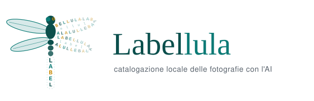
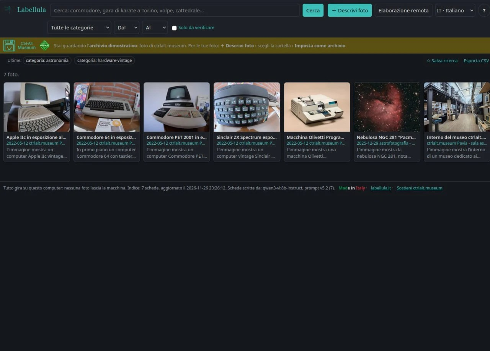
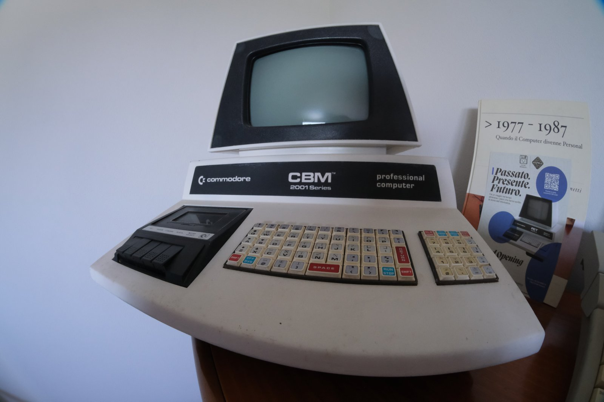

  <b>Il tuo archivio fotografico, finalmente ritrovabile. In italiano.</b>

  
  
  
  
  
  
  

  <b>Made in Italy</b>, per sostenere il museo dell'informatica di Pavia 
  
  &nbsp;&nbsp;&nbsp;
  

# Labellula

**Catalogazione di archivi fotografici con l'intelligenza artificiale.**
Labellula guarda ogni foto con un modello di intelligenza artificiale e scrive una scheda in italiano: titolo, descrizione, scritte leggibili, luogo e periodo con la fonte di ogni informazione, occasione, parole chiave. Poi puoi cercare in tutto l'archivio come in un motore di ricerca, per parole o per significato. Le schede sono file di testo accanto alle foto: restano tue, si leggono con qualsiasi programma e sopravvivono a Labellula.

> **Cosa serve, prima di tutto.**
> - **Gratis sul tuo PC**, se hai una **scheda video con circa 12 GB di memoria**: NVIDIA RTX 3060 12 GB o superiore (provato su RTX 3080 Ti), oppure un Mac Apple Silicon con almeno 16 GB (non ancora provato). Le foto non escono mai dal computer. Senza una scheda video adatta Labellula si installa lo stesso, ma descrivere le foto diventa troppo lento: va bene solo per provarne poche.
> - **Senza scheda video adatta: elaborazione remota a crediti** *(in preparazione)*. Le foto vengono descritte dalla GPU di Labellula: al server arriva solo una copia ridotta senza metadati, che non viene salvata, e la scheda torna subito sul tuo PC. La ricerca resta gratuita e sul tuo computer. **I crediti sostengono [ctrlalt.museum](https://ctrlalt.museum/).**

Il nome viene da *label* (etichetta) e *libellula*. **Labellula è un progetto italiano**, ideato e sviluppato a Pavia da Dino Baldi per sostenere [ctrlalt.museum](https://ctrlalt.museum/), il museo dell'informatica dell'associazione culturale comPVter. Sito: **[labellula.it](https://labellula.it)** (in preparazione).

## Perché Labellula

Abbiamo tutti decine di migliaia di foto che nessuno riguarda più, perché ritrovarle è impossibile: «quella del Commodore al museo», «la gara di karate a Torino», «la volpe in Abruzzo». Musei e associazioni hanno lo stesso problema con le collezioni: fotografare è facile, catalogare no.

Labellula è nata così: per catalogare le migliaia di foto di computer storici di [**ctrlalt.museum**](https://ctrlalt.museum/), il museo dell'informatica dell'associazione culturale [**comPVter**](https://ctrlalt.museum/compvter/) di Pavia, e un archivio di famiglia di 27.000 foto in vent'anni. Le regole che ci siamo dati:

- **Le foto restano tue.** In locale non escono dal PC; con l'elaborazione remota esce solo una copia ridotta, senza metadati, che non viene conservata. Niente cloud di terzi, niente abbonamenti.
- **In italiano, e con giudizio.** Le schede dicono da dove viene ogni informazione (EXIF, GPS, nome della cartella, immagine) e cosa è incerto. Il modello propone, una persona decide.
- **I tuoi nomi delle cartelle valgono oro.** `2024-02-04 gara karate Torino` è già una catalogazione: Labellula la legge, la verifica con data e GPS e la usa.
- **Formati aperti, software libero.** Testo semplice accanto alle foto, codice sotto licenza AGPL-3.0.

**Ti piace il progetto?** Una stella su GitHub aiuta a farlo conoscere. E una [donazione a ctrlalt.museum](https://ctrlalt.museum/ctrlalter/) aiuta a tenere accesi i computer che hanno fatto la storia.

## Un esempio

Scheda generata in locale da Labellula (`qwen3-vl:8b-instruct`, prompt v4, circa 4 secondi su una RTX 3080 Ti), senza ritocchi. Con il prompt v5 la scheda ha in più titolo, occasione, fonti e dubbi:

> **DESCRIZIONE:** L'immagine mostra un computer Commodore CBM 2001 Series, un modello professionale degli anni '80. Il dispositivo ha un design integrato con schermo monocromatico incastonato nella parte superiore, tastiera beige con pulsanti colorati (rosso, blu, verde), e un pannello nero sulla sinistra con una piccola finestra e alcuni interruttori. […] Sul lato destro dell'immagine, accanto al computer, c'è un cartello verticale bianco con testo in italiano, che parla del periodo 1977-1987 e della trasformazione del computer in un prodotto personale. […]
>
> **TESTI VISIBILI:** commodore, CBM™, professional computer, 2001 Series, > 1977 - 1987, Quando il Computer divenne Personal, Passato. Presente. Futuro., Opening, PET
>
> **CATEGORIA:** hardware-vintage · **PERSONE:** nessuna
>
> **PAROLE CHIAVE:** Commodore, CBM 2001, schermo monocromatico, tastiera beige, pulsanti colorati, cartello storico, computer vintage, esposizione, anni '80

[Scheda completa](examples/schede/03_hardware-vintage.txt) · [altri 22 esempi, compresi gli errori del modello](examples/README.md)

## Inizia in 5 minuti

Scarica Labellula (**Code › Download ZIP** su GitHub, oppure `git clone https://github.com/dinobaldi/labellula.git`) e lancia l'installatore. Lo ZIP si può anche passare a qualcuno così com'è: dentro c'è **`LEGGIMI - COME INSTALLARE.txt`**, con le istruzioni per chi non usa GitHub.

| Sistema | Come |
|---|---|
| Windows 10/11 | doppio clic su **`Installa-Windows.cmd`** |
| macOS | nel Terminale, nella cartella di Labellula: `sh tools/installa.sh` |
| Linux | nel terminale, nella cartella di Labellula: `sh tools/installa.sh` |

L'installatore **controlla prima l'hardware** (scheda video, memoria, spazio su disco) e chiede conferma prima di ogni download:
- **computer adatto** → installa Ollama, scarica il modello giusto per la tua scheda video e misura la velocità su una foto di esempio;
- **computer non adatto** (per esempio un Mac con processore Intel) → **non scarica niente di inutile** e imposta l'elaborazione remota; la ricerca funziona comunque.

Non hai mai usato GitHub o il terminale? Nella guida c'è l'**[installazione passo passo per Windows, macOS e Linux](docs/GUIDA.md#2-installazione-passo-passo-anche-se-non-hai-mai-usato-github)**. Hai un altro computer con una buona scheda video nella stessa rete? Puoi usare la sua: [GPU di un altro computer](docs/GUIDA.md#3bis-usare-la-gpu-di-un-altro-computer-di-casa-o-dellufficio).

Alla fine si apre la pagina <http://localhost:8765>: clic su **＋ Descrivi foto**, scegli la cartella, **Imposta come archivio**, prova con 20 foto. Puoi rifare il controllo quando vuoi con `python -m labellula verifica`. Tutti i dettagli sono nella **[guida completa](docs/GUIDA.md)**.

## Tre modi di usare Labellula

1. **Tutto sul tuo PC, gratis**, se hai una scheda video con circa 12 GB. Le foto non escono mai dal computer. Una donazione a [ctrlalt.museum](https://ctrlalt.museum/ctrlalter/) è benvenuta.
2. **Elaborazione remota, a crediti** *(in preparazione)*. Senza GPU: le foto vengono descritte dalla GPU di Labellula; arriva solo una copia ridotta senza metadati, che non viene salvata. **I proventi sostengono ctrlalt.museum.**
3. **Chiavi in mano** per musei e archivi fotografici, su richiesta.

## Cosa fa

**Descrive.** Per ogni foto scrive una scheda di testo in `_txt/` accanto alla foto: titolo, descrizione, testi leggibili, luogo e periodo **con la fonte di ogni informazione** (EXIF, GPS, cartella, immagine), occasione, persone (senza riconoscerle), aspetti fotografici, parole chiave e i dubbi del modello.

**Usa i nomi delle cartelle, verificandoli.** In molti archivi la catalogazione è già nelle cartelle (`2024-02-04 gara karate Torino`). Labellula confronta la data della cartella con l'EXIF e il luogo con il GPS e con un elenco offline di 145.000 località (anche con i nomi italiani: Ginevra = Genève), e passa al modello informazioni già pesate: "confermato", "presunto", "in contrasto". Su 22 foto reali il luogo "non determinabile" è sceso da 12 (prompt v4) a 6 (v5).

**Cerca.** Per parole (senza badare ad accenti e maiuscole, con radici e sinonimi) e per significato (`bge-m3`): "automobile rossa" trova anche "spider color fiamma". Filtri per categoria, anni, cartella, persona; foto simili; esportazione CSV. Su 27.000 schede le ricerche rispondono in meno di 0,1 s.

**In cinque lingue.** Pagina e schede in italiano, English, Français, Deutsch ed Español, da un menu a discesa. La ricerca per significato funziona anche tra lingue diverse.

**Anche dal telefono.** La ricerca si apre da telefono e tablet sulla Wi-Fi di casa, con una password. Si può usare anche la scheda video di un altro computer della rete.

**Prova subito.** Al primo avvio c'è un archivio dimostrativo con le foto di ctrlalt.museum (Olivetti Programma 101, Commodore PET, Commodore 64, ZX Spectrum, Apple IIc), già descritte: si può provare la ricerca prima di descrivere le proprie foto, anche senza GPU.

**Rispetta la privacy.** Al modello arriva solo una copia ridotta (1344 px) senza EXIF e GPS. La pagina risponde solo a questo computer, oppure alla rete di casa con password. Il riconoscimento dei volti è un modulo separato, facoltativo e sempre locale. Formati JPG, PNG e HEIC.

| | |
|---|---|
| Velocità | ~4 s a foto (prompt v4), ~6,5 s (v5) su RTX 3080 Ti |
| Modelli | `qwen3-vl:8b-instruct` (descrizione), `bge-m3` (significato), via Ollama |
| Formato | testo UTF-8 accanto alle foto; in arrivo XMP/IPTC |
| Dipendenze | Python con 7 librerie; nessun servizio cloud |

## Documentazione
- [Guida completa](docs/GUIDA.md): installazione, configurazione, uso, problemi frequenti
- [Novità](CHANGELOG.md)
- [Licenze di terze parti](docs/LICENZE.md)
- [Come contribuire](CONTRIBUTING.md) · [Sicurezza](SECURITY.md)
- [Esempi di schede, compresi gli errori del modello](examples/README.md)

## Struttura del codice
| Cartella | Contenuto |
|---|---|
| `labellula/` | il programma: descrizione (`descrizione.py`, `foto.py`, `indizi.py`, `motori.py`), ricerca (`indice.py`, `semantico.py`), pagina web (`server.py`, `lavori.py`, `web/`) |
| `tests/` | test automatici: `python -m unittest discover -s tests -t .` |
| `tools/` | avvio con doppio clic, strumenti di migrazione |

## Licenza
Il codice di Labellula è software libero, distribuito con la licenza **[GNU Affero General Public License v3.0](LICENSE)** (AGPL-3.0):
puoi usarlo, studiarlo, modificarlo e ridistribuirlo; se lo modifichi e lo offri ad altri come servizio in rete, devi rendere disponibile anche il tuo codice.

Copyright © 2026 Dino Baldi.

Non sono coperti dalla licenza del codice: i loghi di ctrlalt.museum e comPVter (marchi dell'associazione) e le foto di esempio in `examples/`, di Dino Baldi e di ctrlalt.museum, che hanno licenza [CC BY 4.0](https://creativecommons.org/licenses/by/4.0/deed.it). I modelli di intelligenza artificiale (scaricati con Ollama), le librerie e i dati hanno licenze proprie: vedi [licenze di terze parti](docs/LICENZE.md).

## Autore
Dino Baldi · per [ctrlalt.museum](https://ctrlalt.museum/) e l'associazione [comPVter](https://ctrlalt.museum/compvter/)
